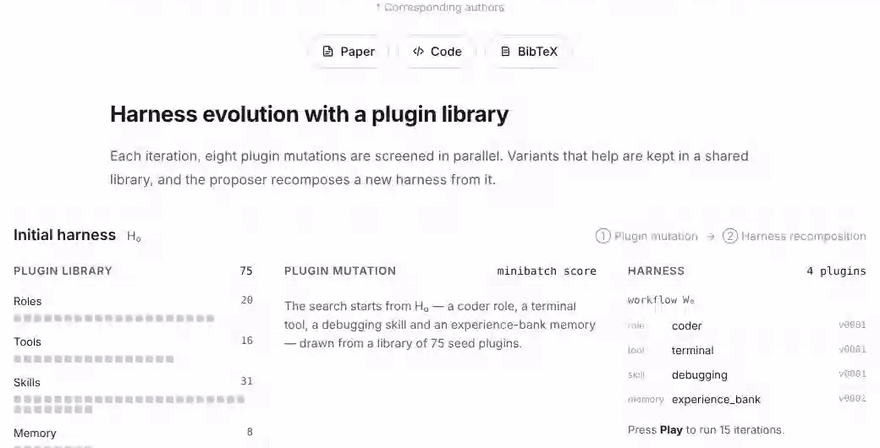
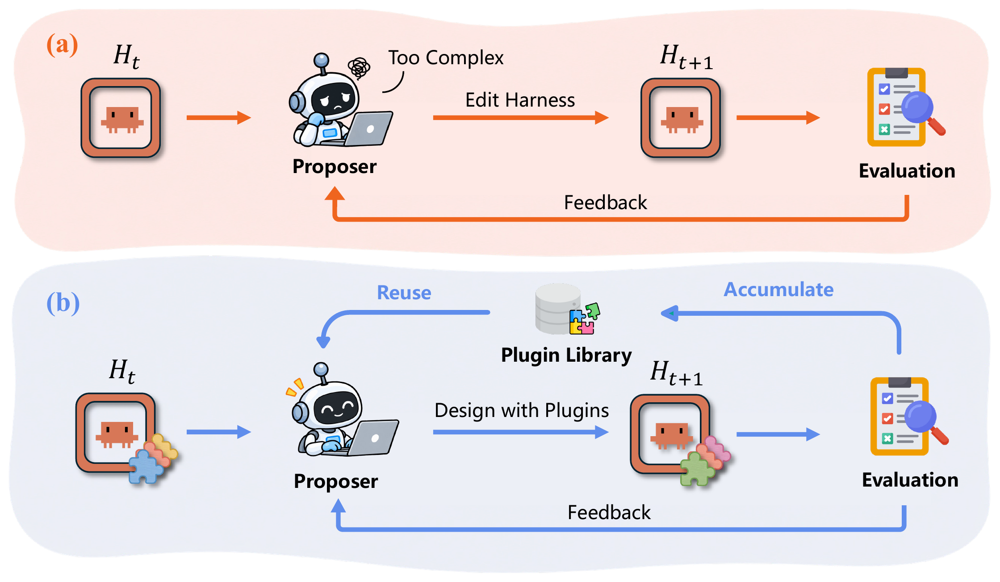
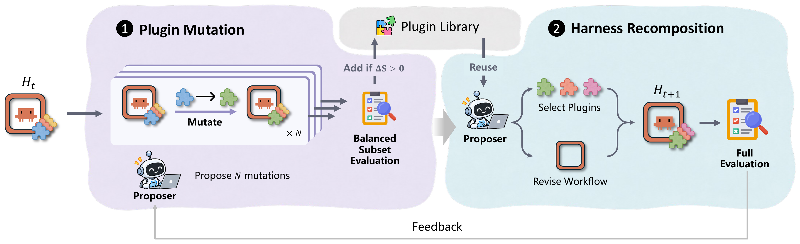
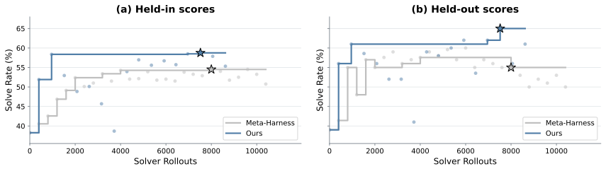

<div align="center">

# 🧩 PluginRSI

### Recursive Improvement of Agent Harnesses with Reusable Plugins

Yaorui Shi<sup>1,2</sup>, Yuchun Miao<sup>2,3</sup>, Yuxin Chen<sup>2,4</sup>, Jiayuan Zhang<sup>2</sup>, Yueqing Sun<sup>2</sup>, Xierui Song<sup>2,†</sup>, Xiang Wang<sup>1</sup>, An Zhang<sup>1,†</sup>

<sup>1</sup>University of Science and Technology of China &nbsp; <sup>2</sup>Meituan &nbsp; <sup>3</sup>Wuhan University &nbsp; <sup>4</sup>National University of Singapore
<br><sub>† Corresponding authors</sub>

<p>
  <a href="https://syr-cn.github.io/PluginRSI/"></a>
  <a href="https://arxiv.org/abs/2609.32423"></a>
  <a href="https://huggingface.co/papers/2609.32423"></a>
  <a href="LICENSE"></a>
  
</p>

<p>
  <a href="#method">Method</a> ·
  <a href="#results">Results</a> ·
  <a href="#quick-start">Quick Start</a> ·
  <a href="#agent-skills">Agent Skills</a> ·
  <a href="#citation">Citation</a>
</p>

<a href="https://syr-cn.github.io/PluginRSI/#demo"></a>
<br><sub>Each iteration screens eight plugin mutations; the ones that help join the library (blue), then the harness is recomposed from it.
<a href="https://syr-cn.github.io/PluginRSI/#demo">Step through all 15 iterations on the project page →</a></sub>

</div>

> *“Everything is a plugin.”* — DeepSeek Harness
>
> **PluginRSI** represents an agent harness as a **workflow** over **atomized plugins**: roles, tools, skills and memory.
> Rather than rewriting the whole harness at each step, it improves individual plugins, keeps the ones that help
> in a shared **plugin library**, and recomposes them into new harnesses. Mechanisms found in one iteration remain
> available in later ones.

## 📰 News

- **[2026-10-18]** 🌐 The [project page](https://syr-cn.github.io/PluginRSI/) is live, with an interactive replay of the search.
- **[2026-10-07]** 🛠️ Code, seed plugin libraries and data splits are released.
- **[2026-09-26]** 📄 The paper is on [arXiv](https://arxiv.org/abs/2609.32423).

## ✨ Highlights

- 🔬 **Plugin mutation**: *N* parallel branches each mutate one plugin on a balanced minibatch of solved and failed tasks. The rest of the harness stays fixed.
- 📚 **Plugin library**: a variant is added to the library only if it beats its parent on the same minibatch.
- 🔀 **Harness recomposition**: the proposer selects plugins from the updated library and revises the workflow. The new harness must improve full held-in accuracy to replace the incumbent.
- 🔁 **Reusable across runs**: starting from the initial harness with the evolved library reaches 69% held-out on SWE-bench Verified after two steps, compared with 65% without the library.

<a name="method"></a>

## 🏗️ Method

<div align="center">

<br><br>

</div>

<br>

| Paper | Code |
| --- | --- |
| Optimization loop (Alg. 1) | [`search/loop.py`](src/pluginrsi/search/loop.py) |
| ① Plugin mutation + balanced minibatch | [`search/mutation.py`](src/pluginrsi/search/mutation.py) |
| ② Harness recomposition | `Search.harness_recomposition` in [`search/loop.py`](src/pluginrsi/search/loop.py) |
| Proposer instructions | [`prompts/`](src/pluginrsi/prompts) |
| Plugin schema `H(W, P)` | [`schemas.py`](src/pluginrsi/schemas.py), [`loader.py`](src/pluginrsi/loader.py), [`contracts.py`](src/pluginrsi/contracts.py) |
| Initial harnesses `H₀` | [`seeds/agents/`](seeds/agents) |
| Initial plugin library `L` | [`seeds/plugin_library/`](seeds/plugin_library) |

<a name="results"></a>

## 📊 Results

<div align="center">

| Held-out | ReAct (few-shot) | GEPA | DGM | Meta-Harness | **PluginRSI** |
| --- | :---: | :---: | :---: | :---: | :---: |
| SWE-bench Verified (Kimi-K3) | 47.0 | 62.0 | 55.0 | 63.0 | **69.0** |
| SWE-bench Verified (GPT-5.6 Terra) | 55.0 | 51.0 | 50.0 | 55.0 | **65.0** |
| Terminal-Bench 2.1 (Kimi-K3) | 50.0<sup>†</sup> | 63.3 | 60.0 | 66.7 | **73.3** |
| QA transfer, 5 unseen domains (Kimi-K3) | 0.332 | 0.472 | — | 0.568 | **0.588** |

<sub>Resolve rate (%) or accuracy on held-out splits. Each SWE-bench row lists the harness optimized and evaluated with that model. <sup>†</sup>Zero-shot ReAct.</sub>

<br><br>


<br><sub>PluginRSI reaches stronger harnesses with fewer solver rollouts, and its held-in gains carry over to held-out tasks.</sub>

</div>

<details>
<summary><b>Cross-model transfer on SWE-bench Verified</b> — harnesses frozen after optimization, then run with other solvers</summary>

<br>

| Optimized with | Method | GPT-5.6 Terra | Kimi-K3 | GLM-5.2 |
| --- | --- | :---: | :---: | :---: |
| GPT-5.6 Terra | Meta-Harness | 55.0 | 53.0 | 44.0 |
| | **PluginRSI** | **65.0** | **60.0** | **52.0** |
| Kimi-K3 | Meta-Harness | 60.0 | 63.0 | 59.0 |
| | **PluginRSI** | **64.0** | **69.0** | **64.0** |

<sub>Held-out resolve rate (%) on 100 tasks. Full tables, including held-in scores and all baselines, are in the paper.</sub>

</details>

<details>
<summary><b>Examples of discovered plugins</b> — what plugin mutation actually finds</summary>

<br>

| Category | Discovered mechanism | Minibatch (before → after) |
| --- | --- | :---: |
| Role | Repair-scope control | 10/20 → 13/20 |
| Role | Discriminative checks and lifecycle continuity | 10/20 → 13/20 |
| Skill | Semantic source preservation | 10/20 → 13/20 |
| Skill | Explicit precedence and representation checks | 10/20 → 13/20 |
| Skill | Public-path checks with reachability controls | 10/20 → 14/20 |
| Memory | Incremental evidence retrieval | 10/19 → 14/19 |
| Memory | Test-outcome classification | 10/20 → 12/20 |
| Tool | Failure-aware terminal feedback | 10/20 → 14/20 |

<sub>Before/after examples for each category are on the <a href="https://syr-cn.github.io/PluginRSI/#plugins">project page</a> and in Appendix K of the paper.</sub>

</details>

<a name="quick-start"></a>

## 🚀 Quick Start

```bash
# 1. Install (Python 3.11+; Docker is needed for SWE-bench / Terminal-Bench)
python3 -m venv .venv && source .venv/bin/activate
pip install -e '.[test,data,qa,harbor]'
cp .env.example .env            # fill in SOLVER_* / EVOLVER_* endpoints

# 2. Prepare data (pick a benchmark: swe | terminal_bench | qa_transfer)
mkdir -p logs
python3 scripts/prepare_hf_data.py swe 2>&1 | tee logs/prepare_swe.log

# 3. Set the model names in configs/swe.yaml, then check and launch
bash scripts/launch_experiment.sh check --config configs/swe.yaml
bash scripts/launch_experiment.sh start --config configs/swe.yaml
```

<a name="agent-skills"></a>

## 🤖 Let Your Coding Agent Do It

The detailed procedures live in agent skills under [`.claude/skills/`](.claude/skills), so you don't
have to read a manual. Open the repository in [Claude Code](https://claude.com/claude-code) and ask in plain
language; the matching skill loads automatically.

| Skill | What it covers | Try asking |
| --- | --- | --- |
| [`pluginrsi-reproduce`](.claude/skills/pluginrsi-reproduce/SKILL.md) | Install, data download, model & sandbox settings, launch, resume, held-out report | *"Reproduce the SWE-bench Verified experiment with my endpoint."* |
| [`pluginrsi-extend`](.claude/skills/pluginrsi-extend/SKILL.md) | Write plugins, add benchmarks, change the search algorithm, offline tests | *"Add a new search stage that prunes unused plugins after recomposition."* |

> [!TIP]
> Using another agent (Codex, Cursor, Gemini CLI, ...)? Tell it to read the relevant `SKILL.md` first.
> The full reference is in [`reference.md`](.claude/skills/pluginrsi-reproduce/reference.md).

## 📁 Repository Layout

```text
PluginRSI/
├── src/pluginrsi/          # core package (CLI: `pluginrsi`)
│   ├── search/             #   PluginRSI loop (loop.py, mutation.py) and proposer agent
│   ├── prompts/            #   proposer instructions for each stage
│   └── evaluation/         #   benchmark runners and graders
├── seeds/
│   ├── agents/             # initial harnesses (workflow + harness.yaml)
│   ├── plugin_library/     # initial plugin library (role / tool / skill / memory)
│   └── plugin_library_qa/  # plugin library for QA transfer
├── configs/                # swe.yaml · terminal_bench.yaml · qa_transfer.yaml
├── datasets/               # fixed held-in / held-out split IDs
├── scripts/                # data preparation and experiment launcher
├── docs/                   # project page (GitHub Pages)
└── .claude/skills/         # agent skills: reproduce · extend
```

## 🙏 Acknowledgements

The seed plugin library adapts roles, skills, tools and memory structures from sources including
[SWE-agent](https://github.com/SWE-agent/SWE-agent), [mini-SWE-agent](https://github.com/SWE-agent/mini-swe-agent),
[Agentless](https://github.com/OpenAutoCoder/Agentless), [SWE-smith](https://github.com/SWE-bench/SWE-smith),
[Aider](https://github.com/Aider-AI/aider), the [OpenHands](https://github.com/All-Hands-AI/OpenHands) Software Agent SDK,
DeepSeek Harness, the Agent Skills specification, [Anthropic Skills](https://github.com/anthropics/skills) and Superpowers.
Each plugin records its sources in its provenance metadata. We thank the authors of these projects.

## 📄 License

Released under the [MIT License](LICENSE).

<a name="citation"></a>

## 📝 Citation

If you find PluginRSI useful, please consider citing:

```bibtex
@article{shi2026pluginrsi,
  title   = {PluginRSI: Recursive Improvement of Agent Harnesses with Reusable Plugins},
  author  = {Shi, Yaorui and Miao, Yuchun and Chen, Yuxin and Zhang, Jiayuan and
             Sun, Yueqing and Song, Xierui and Wang, Xiang and Zhang, An},
  journal = {arXiv preprint arXiv:2609.32423},
  year    = {2026}
}
```
